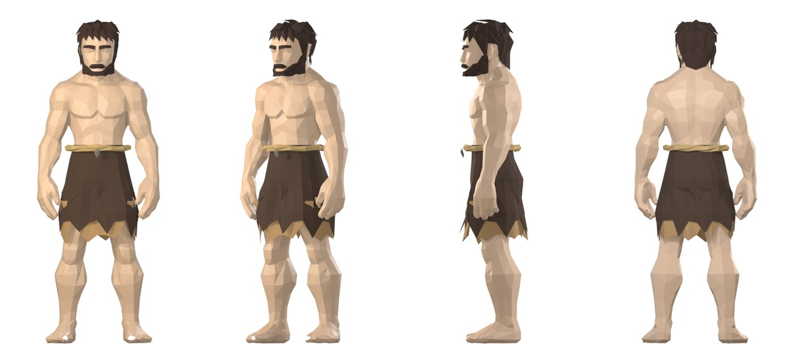
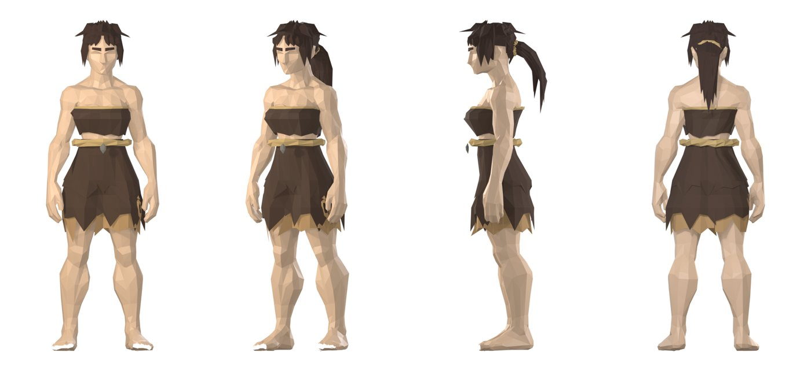

# Claude + Blender skills for low-poly humanoids and worlds

Skills, specs and Python scripts that let a coding agent (Claude Code or any agent that can run Python and Blender) **build, rig, dress,
animate and check low-poly game characters and a low-poly world entirely in code** — no paid asset store, no paid API, no hand modelling.
Everything is measured: every builder writes a file, then a gate script measures that file and exits 1 when it is off-spec.




## Requirements
- Python 3.10+ with `numpy scipy trimesh` (some scripts also use `Pillow`)
- Blender 4.x / 5.x (tested on 5.2.2 LTS) — scripts run headless: `blender -b -P <script>.py -- <args>`
- Optional, only for the image→3D character route in `skills/stylized-lowpoly-humanoid`: Hunyuan3D-2 (free, open weights) running locally.
  Everything else is pure code.

## How an agent uses this
Each folder under `skills/` is a skill: `SKILL.md` says **when** to use it, the exact commands, the gates, and the mistakes already paid
for. Point your agent at the SKILL.md for the task (Claude Code: put the folder in `~/.claude/skills/` or reference it from `CLAUDE.md`).
The rule all skills follow: **build → measure the exported file → fix at the layer that failed → never relax a threshold to pass.**

## Skills
| skill | what it does |
|---|---|
| `low-poly-origami-*` + `lpm.py` / `check_lpm.py` (root) | faceless low-poly human base mesh (m/f) in pure Python, sockets, grippable hands, 15 measured gates — see `docs/LPM.md` |
| `humanoid_combined/`, `lpd_detailed/` | combined / detailed humanoid drafts (tiers ~1.2k / ~2.4k tris) |
| `stylized-lowpoly-humanoid` | primal muscular humanoid: rig (`rig_body_blender.py`: measured joints, heat weights, arm/torso ownership at the armpit, a skirt thigh field shared by every skirt layer), garments built from the body (`build_bandeau.py`, torn outfits), hair/brows |
| `character-fitter` | fit hair/outfit onto any body → Fitting Report + 10-pose test; play old clips on a dressed rig and measure skin-through-cloth by ID render (`clip_check_blender.py`); delete skin hidden under opaque cloth (`hidden_skin_blender.py`, the game-industry "body masking"); keep arms out of a top (`arm_clearance_blender.py`); bake clips into one game GLB (`bake_clips_blender.py`) |
| `humanoid-rig-animation`, `settler-actions` | settler skeleton (goc/hips/spine/chest/clavicle/upperarm/forearm/hand/thigh/shin/foot + leg IK), retarget, action clips (idle, walk, run, chop, carry, put down), contact/slide gates |
| `humanoid-replaceable-assets` | hand tools (axe, pick, hoe, shovel, bow, rod, basket) with a grip contract, hair/shoes/garments for the humanoid |
| `quadruped-rig-animation`, `build-stylized-organic-model` | 4-legged animals (rig, gait, graze) and stylized organic models (masses → smooth union → marching cubes → decimate) |
| `procedural-low-poly-world`, `lowpoly-grass`, `las-physics` | mountains/waterfalls/rivers pack, world scale hierarchy (settler 1.8 m anchor), grass with wind in the vertex shader, falling/breaking with Bullet |
| `settler-storage` | storage slots, stacking rules |
| `lpms/` | the asset loop: render · edit · revisions · settler-in-hand · clipping vs body |
| `specs/WORLD_COLOR_SPEC_V1.png`, `starter-pack/`, `theme/` | world colour sheet, starter humans/animals specs and presets, palette |

## Folder map
```
skills/<skill>/SKILL.md, scripts/, spec/      the skills
lpm.py check_lpm.py hand.py hair*.py          code-built base humanoid (root)
lpms/                                          asset build/edit loop
assets/**/  (*.py, *.json only)               builders + measurements for the reference characters, animals, tools, world pack
specs/ starter-pack/ theme/                    world + starter specs
docs/LPM.md                                    the base-humanoid manual
```
Binary outputs (GLB, renders, videos) are not in the repo — every one of them is rebuilt by the scripts.

## Licence
MIT — see `LICENSE`. No third-party assets are included; specs that were measured from paid packs were left out on purpose.
